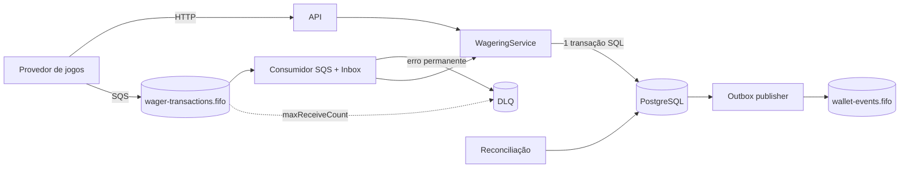

# Arquitetura

Este documento registra as decisões que sustentam a consistência financeira do
Wagering Processor, os trade-offs assumidos e as limitações conhecidas.

## Princípios

1. **O banco é a fonte da verdade e a última linha de defesa.** Toda
   invariante importante existe na aplicação *e* no PostgreSQL (CHECK, UNIQUE,
   FK, trigger). Um bug na aplicação pode rejeitar uma operação; não pode
   corromper saldo.
2. **Uma operação = uma transação SQL.** Transação de aposta, saldo, ledger,
   evento do Outbox e marcação do Inbox são gravados no mesmo `COMMIT`.
3. **Nunca `number` para dinheiro.** `Money` usa `decimal.js`, exatamente 2
   casas e moeda obrigatória; no banco, `numeric(20,2)`.
4. **Idempotência persistente, não em memória.** Toda entrada (HTTP ou fila)
   carrega uma chave única gravada com a transação.
5. **Entrega at-least-once + consumidores idempotentes** em vez de tentar
   exactly-once distribuído.

## Visão geral

## Modelo de dados

| Tabela | Papel | Invariantes no banco |
| --- | --- | --- |
| `wallets` | Saldo materializado e contador do ledger | `balance >= 0`; `UNIQUE (player_id, currency)` |
| `ledger_entries` | Lançamentos imutáveis (CREDIT/DEBIT) | `amount > 0`; `balance_after >= 0`; `UNIQUE (wallet_id, sequence)`; `UNIQUE (wallet_id, reference_type, reference_id)`; **trigger bloqueia UPDATE/DELETE/TRUNCATE** |
| `wager_transactions` | Cada operação recebida, sua decisão e a resposta canônica | `UNIQUE (idempotency_key)`; `reference_key` obrigatório exceto em BET; índices únicos parciais: no máximo **uma liquidação** (WIN/LOSS) e **uma reversão** (REFUND/ROLLBACK) processadas por alvo |
| `inbox_messages` | Mensagens recebidas da fila | `UNIQUE (source, message_id)` |
| `outbox_events` | Eventos a publicar | índice parcial dos pendentes |

Cada lançamento guarda `sequence` (1, 2, 3… por carteira, sem lacunas) e
`balance_after`. Isso dá paginação estável, auditoria ("qual era o saldo
depois do lançamento 42?") e permite à reconciliação detectar lançamentos
faltando ou alterados.

**Saldo materializado + ledger**, em vez de calcular o saldo somando o
ledger a cada aposta: a leitura do saldo é O(1) sob lock, e a consistência
entre os dois é garantida porque um único ponto do código
(`ledger.writer.ts › postToWallet`) altera ambos juntos, e verificada pela
reconciliação.

## Concorrência

**Decisão:** lock pessimista por carteira (`SELECT … FOR UPDATE`) com
isolamento `READ COMMITTED`.

Fluxo de `WageringService.processLocked`:

1. `SELECT … FROM wallets WHERE id = ? FOR UPDATE` — serializa todas as
   operações da carteira.
2. Procura a `idempotency_key` **já com o lock**. Como em `READ COMMITTED`
   cada instrução enxerga o último `COMMIT`, a segunda de duas requisições
   idênticas vê a primeira e responde com replay.
3. Decide (regras puras em `domain/wagering/wager-rules.ts`), aplica no saldo
   e no ledger, grava Outbox/Inbox, resolve `PENDING_REFERENCE` dependentes.
4. `COMMIT`.

Por que não lock otimista (coluna `version`)? Em apostas a contenção é alta
justamente no caso que importa (várias apostas simultâneas do mesmo jogador)
e o otimista transforma isso em retentativas e respostas 409 para o cliente.
O lock por linha é curto (sem I/O externo dentro da transação), não bloqueia
outras carteiras e dá ordem determinística.

Por que não `SERIALIZABLE`? Exigiria retry de falhas de serialização em todo
caminho e não traz garantia adicional aqui: todo conflito relevante passa pela
linha da carteira.

**Corrida residual:** a mesma chave usada ao mesmo tempo em *carteiras
diferentes* (locks diferentes). A `UNIQUE (idempotency_key)` faz uma das
transações falhar; ela é revertida por inteiro e respondida com replay da
vencedora (`replayAfterConflict`).

**Deadlocks:** cada transação trava no máximo uma carteira, e depois linhas
de transações pendentes daquela carteira, sempre na mesma ordem.

Cobertos pelos testes de integração: 50 requisições idênticas em paralelo, duas apostas de
R$ 80 contra R$ 100, carga mista com duplicatas, e o mesmo cenário com 4
processos independentes e 3 instâncias da API.

## Idempotência

| Camada | Chave | Protege contra |
| --- | --- | --- |
| HTTP / comando | `idempotencyKey` (id da transação no provedor) | Retentativas do provedor, duplicatas HTTP |
| Payload | SHA-256 do payload canônico (chaves ordenadas, valores normalizados) | Reuso da chave com outro conteúdo → `409` |
| Fila | `MessageId` no Inbox | Redelivery da mesma mensagem |
| Saída | `eventId` como `MessageDeduplicationId` | Publicação duplicada do Outbox |

O replay devolve a **resposta armazenada** (`wager_transactions.response`) e
o status HTTP é derivado do status persistido, então é byte a byte igual à
primeira resposta — inclusive para rejeições (`422`).

Rejeições de negócio (saldo insuficiente etc.) são **persistidas**: repetir
uma aposta rejeitada continua rejeitada mesmo que o saldo tenha aumentado
nesse meio-tempo. É o comportamento esperado por provedores de jogos.

## Operações e referências fora de ordem

| Operação | Alvo (`referenceKey`) | Efeito | Regras |
| --- | --- | --- | --- |
| BET | — | débito | saldo suficiente |
| WIN | BET | crédito do prêmio | BET processado, não liquidado, não revertido |
| LOSS | BET | nenhum | idem; `amount = 0` |
| REFUND | BET | crédito do valor apostado | BET não liquidado; valor igual |
| ROLLBACK | BET ou WIN | desfaz (crédito de BET, débito de WIN) | não revertido; valor igual; BET só se não liquidado |

Provedores frequentemente enviam um `ROLLBACK` antes do `BET` que ele
cancela (timeout no meio do caminho), ou um `WIN` antes do `BET`. Nesses
casos a operação é gravada como **`PENDING_REFERENCE`** (HTTP `202`), sem
efeito no saldo. Quando a original é processada, na **mesma transação**, as
pendentes que apontam para ela são resolvidas em cascata (um ROLLBACK de um
WIN que aguardava o BET é resolvido logo após o WIN). Se a original for
rejeitada, as dependentes também são (`REFERENCE_NOT_PROCESSED`).

Um BET que chega depois do seu ROLLBACK é processado e imediatamente
revertido: o ledger mostra os dois lançamentos e o saldo líquido não muda.

## Inbox, Outbox e DLQ

**Consumidor (Inbox).** Para cada mensagem:

- registra/recupera o Inbox por `MessageId` (UNIQUE resolve consumidores concorrentes);
- se já estiver `PROCESSED`/`FAILED`, apenas remove da fila;
- processa com `inboxMessageId` → o Inbox vira `PROCESSED` **no mesmo COMMIT** do efeito;
- **erro permanente** (payload inválido, carteira inexistente, chave reutilizada):
  envia explicitamente à DLQ com `errorCode`/`errorMessage`, marca `FAILED` e
  remove — nessa ordem, para que uma falha no meio faça a mensagem voltar em
  vez de sumir;
- **erro transitório** (banco indisponível, timeout): não remove; aumenta o
  visibility timeout com backoff exponencial e jitter. Ao exceder
  `maxReceiveCount` o próprio SQS move para a DLQ (redrive).

As mensagens são tratadas em sequência por lote para respeitar a ordem FIFO
por `MessageGroupId` (o produtor deve usar o `walletId`).

**Publicador (Outbox).** Eventos são gravados na transação de negócio, então
nunca existe "saldo alterado sem evento" nem "evento sem saldo alterado".

1. **Claim:** transação curta com `FOR UPDATE SKIP LOCKED` que grava um lease
   (`locked_until`) e incrementa `attempts`. Várias instâncias dividem o
   trabalho sem se bloquear.
2. **Publish:** fora de transação — nenhum lock é mantido durante I/O de rede.
3. **Ack:** `PUBLISHED`, ou novo agendamento com backoff, ou `FAILED` após
   `OUTBOX_MAX_ATTEMPTS`. As atualizações exigem `status = PENDING`, então o ACK
   tardio de uma instância que perdeu o lease não desfaz a publicação de outra.

Se o processo morrer entre 1 e 3, o lease expira e outro publicador retoma o
evento (testado com `SIGKILL`). Por isso a entrega é **at-least-once**.

**Ordem:** quando um evento falha, os eventos seguintes da mesma carteira
têm o próximo envio adiado para depois dele, e os do mesmo lote são devolvidos
sem envio. Isso preserva a ordem por carteira no caso comum; não é garantia
estrita com várias instâncias (ver limitações).

## Reconciliação

Verifica, por carteira, em uma única instrução SQL por lote (snapshot
consistente, sem falsos positivos com escritas concorrentes):

| Verificação | Detecta |
| --- | --- |
| `balance = Σ créditos − Σ débitos` | saldo alterado por fora do ledger |
| `balance = balance_after` do último lançamento | idem |
| `balance_after` = saldo acumulado em cada lançamento | lançamento intermediário adulterado |
| `count = max(sequence)` | lançamento removido (lacuna) |
| `last_ledger_sequence = max(sequence)` | contador da carteira divergente |

Disponível como endpoint, job periódico (`RECONCILIATION_INTERVAL_MS`), CLI
(`bun run reconcile`, exit code 1 em divergência) e métrica
`reconciliation_inconsistent_wallets` — que deve disparar alerta crítico se
for maior que zero. O núcleo (`reconciliation.core.ts`) não depende de
framework.

## Observabilidade

- **Logs JSON** com `requestId` propagado por `AsyncLocalStorage` (HTTP via
  `X-Request-Id`, SQS via `MessageId`), um log de acesso por requisição e
  eventos de domínio nomeados (`wager.processed`, `wager.replayed`,
  `sqs.message.dead_lettered`, `outbox.event.failed`,
  `reconciliation.completed`…).
- **Métricas Prometheus** sem dependência externa (`observability/metrics.ts`),
  com rota *template* nas labels HTTP para não explodir cardinalidade e sem ids
  de entidade nas labels. Contadores de negócio só são incrementados após o
  `COMMIT`.
- **Health:** `live` não toca em dependências (falha → reiniciar o processo);
  `ready` verifica banco, schema migrado, SQS (se algum worker estiver ligado),
  loops dos workers e shutdown em andamento (falha → tirar do balanceador).
- **Shutdown gracioso:** `SIGTERM` → readiness passa a `503` → consumidor e
  publicador param de buscar trabalho e terminam o lote em andamento → pool do
  banco fechado.

## Autenticação

Fora do escopo desta versão por decisão explícita: priorizar a consistência
financeira. Extensão prevista, sem mudanças no núcleo:

- **Provedor de jogos → API:** HMAC do corpo com segredo por provedor
  (`X-Signature`, `X-Timestamp` com janela anti-replay) ou mTLS. Um guard do
  Nest valida a assinatura antes do `ValidationPipe`; o `providerId`
  autenticado entraria no escopo da `idempotencyKey`
  (`UNIQUE (provider_id, idempotency_key)`).
- **Fila:** autorização por IAM (quem pode publicar em `wager-transactions`).
- **Endpoints operacionais** (`/reconciliation/*`, `/metrics`): rede interna ou
  guard com token de serviço/OIDC.
- **Jogador:** o `playerId` hoje é validado contra a carteira; com
  autenticação de jogador, viria do token, não do corpo.

## Limitações conhecidas e próximos passos

| Limitação | Impacto | Próximo passo |
| --- | --- | --- |
| Uma liquidação por aposta | Jogos com múltiplos prêmios por rodada precisariam de vários BETs | Modelar `round_id` e permitir N WINs por rodada |
| `PENDING_REFERENCE` sem expiração | Uma derivada cuja original nunca chega fica pendente para sempre | Job que expira após um prazo configurável (`REJECTED: REFERENCE_TIMEOUT`) e alerta via `wager_pending_reference_transactions` |
| Ordem do Outbox é best-effort entre instâncias | Consumidores podem ver eventos de uma carteira fora de ordem em falhas raras | Consumidores usam `ledgerSequence`/`occurredAt`; ou claim apenas do evento mais antigo por partição |
| Carteira muito "quente" | O lock por carteira serializa as apostas daquele jogador | Aceitável (um jogador não gera milhares de apostas/s); se necessário, particionar o saldo |
| Uma moeda por carteira, sem câmbio | — | Nova carteira por moeda (já suportado) |
| Mensagens `FAILED` no Inbox / eventos `FAILED` no Outbox não têm reprocessamento automático | Exigem intervenção | Endpoint/CLI de redrive com auditoria |
| Reconciliação faz varredura completa | Custo cresce com o ledger | Checkpoint incremental por `sequence` |
| Sem autenticação | Ver seção acima | Guard HMAC/mTLS |
| `@nestjs/observe` está configurado com chaves de exemplo | Telemetria externa inativa | Definir chaves reais ou remover o módulo |
